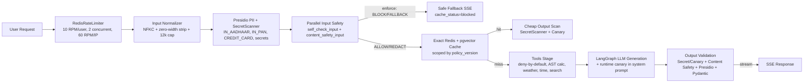

# Semantic Caching SaaS Architecture

An enterprise-grade, AI-powered semantic caching platform designed to minimize LLM latency, eliminate redundant API expenses, and intelligently cache embedding-based queries using vector similarity.

---

## 1. Monorepo Structure

```text
Caching_Project/
├── .gitignore
├── docker-compose.yml
├── README.md
├── docs/
│   └── architecture.md
├── infrastructure/
│   └── (infrastructure-as-code and scripts)
├── backend/
│   ├── alembic/
│   │   ├── versions/
│   │   ├── env.py
│   │   └── script.py.mako
│   ├── alembic.ini
│   ├── requirements.txt
│   ├── Dockerfile
│   ├── .env.example
│   └── app/
│       ├── main.py
│       ├── api/
│       │   └── v1/
│       │       └── endpoints/
│       │           └── health.py
│       ├── config/
│       │   └── settings.py
│       ├── core/
│       ├── database/
│       │   └── session.py
│       ├── models/
│       ├── schemas/
│       │   └── health.py
│       ├── services/
│       │   └── health_service.py
│       ├── repositories/
│       ├── middleware/
│       ├── dependencies/
│       ├── cache/
│       │   └── redis_client.py
│       ├── vector_store/
│       │   └── chroma_client.py
│       ├── ai/
│       │   └── openai_client.py
│       └── utils/
└── frontend/
    ├── package.json
    ├── tsconfig.json
    ├── tailwind.config.js
    ├── postcss.config.js
    ├── next.config.js
    ├── Dockerfile
    ├── .env.example
    └── src/
        ├── app/
        │   ├── api/[...path]/route.ts
        │   ├── login/page.tsx
        │   ├── register/page.tsx
        │   ├── layout.tsx
        │   ├── page.tsx
        │   └── globals.css
        ├── components/
        │   ├── Navbar.tsx
        │   └── ui/
        │       ├── Button.tsx
        │       ├── Card.tsx
        │       └── Input.tsx
        ├── features/
        │   └── auth/
        │       ├── login.tsx
        │       ├── register.tsx
        │       ├── provider.tsx
        │       └── service.ts
        ├── lib/
        │   ├── apiClient.ts
        │   └── utils.ts
```

---

## 2. Infrastructure & Data Responsibilities

- **PostgreSQL**: Stores relational, durable application entities such as users, API keys, cache configuration policies, audit logs, and metadata records. Managed via SQLAlchemy (async engine with connection pooling) and Alembic migrations.
- **Redis**: High-speed, in-memory caching tier responsible for caching exact match responses, low-latency TTL keys, cache lock tokens, and metadata lookup caches.
- **ChromaDB**: Dedicated vector database storing dense embeddings of prompt queries and performing approximate nearest-neighbor (ANN) similarity search to enable semantic matching.
- **OpenAI API**: Secure server-side interface configured to generate vector representations (`text-embedding-3-small`) and LLM responses (`gpt-4o`). Never exposed directly to the browser.

---

## 3. Quickstart & Local Setup

### Option A: Complete Docker Compose Stack

Run all 5 containers (PostgreSQL, Redis, ChromaDB, FastAPI backend, Next.js frontend) with a single command:

```bash
docker-compose up --build
```

- **Frontend**: [http://localhost:3000](http://localhost:3000)
- **Backend API Docs**: [http://localhost:8000/docs](http://localhost:8000/docs)
- **Backend Health Check**: [http://localhost:8000/api/v1/health](http://localhost:8000/api/v1/health)
- **ChromaDB Direct Endpoint**: [http://localhost:8001](http://localhost:8001)

---

### Option B: Local Development Execution

#### 1. Backend Setup (Python 3.12+)

```bash
cd backend

# Create and activate virtual environment
python -m venv .venv
# On Windows:
.venv\Scripts\activate
# On Linux/macOS:
source .venv/bin/activate

# Install dependencies
pip install -r requirements.txt

# Copy environment configuration
cp .env.example .env

# Run database migrations (when database is up)
alembic upgrade head

# Start FastAPI server
uvicorn app.main:app --reload --port 8000
```

#### 2. Frontend Setup (Node.js 20+)

```bash
cd frontend

# Copy environment configuration
cp .env.example .env.local

# Install dependencies
npm install

# Start development server
npm run dev
```

Visit [http://localhost:3000](http://localhost:3000) to sign in or register. The backend now exposes an authenticated, general-purpose streaming chatbot API. The current frontend playground is still the legacy document-RAG interface; the chatbot UI is a later implementation phase.

---

## 4. API Endpoints

- `GET /api/v1/health`: Checks FastAPI and PostgreSQL availability. ChromaDB is not used by the general chatbot.
- `GET /api/v1/providers` and `GET /api/v1/models`: List backend-configured chatbot providers and model options.
- `POST /api/v1/conversations`, `GET /api/v1/conversations`, `GET/PATCH/DELETE /api/v1/conversations/{id}`: Authenticated conversation management with ownership enforcement.
- `POST /api/v1/chat/completions`: Authenticated SSE chat streaming. Events are `response.start`, `content.delta`, `usage`, `response.complete`, and `response.error`.
- `GET /`: Basic API status and route discovery.
- `GET /docs`: Swagger UI for OpenAPI specifications.

### Hybrid local run (databases in Docker, apps on the host)

Start Docker Desktop first, then from the project root start only the infrastructure:

```bash
docker compose up -d postgres chroma redis
```

In a backend PowerShell terminal, activate `backend/.venv`, install `requirements.txt`, then point the host process at Compose's mapped ports and migrate before starting FastAPI:

```powershell
cd backend
.\.venv\Scripts\Activate.ps1
pip install -r requirements.txt
$env:DATABASE_URL = ((Get-Content .env | Where-Object { $_ -like 'DATABASE_URL=*' }).Substring(13) -replace ':5432/', ':5433/')
$env:CHROMA_HOST = "localhost"
$env:CHROMA_PORT = "8001"
$env:REDIS_URL = "redis://localhost:6379/0"
alembic upgrade head
uvicorn app.main:app --reload --host 127.0.0.1 --port 8080
```

In a separate frontend terminal, run `npm run dev -- --hostname 127.0.0.1` from `frontend/`. The host-run backend uses the local `.env` ports (`5433` for PostgreSQL, `8001` for ChromaDB, and `6379` for Redis); Compose networking overrides these values when the backend container is used.

---

## AI Guardrails, Rate Limiting & Tool Calling

### Architecture



### Request Lifecycle & Failure Behavior
- **Input:** `POST /api/v1/chat/completions` (`backend/app/api/v1/endpoints/chatbot.py`) and `POST /api/v1/audio/transcribe` call `GuardrailsService.check_input()` (`backend/app/guardrails/service.py`).
- **Privacy-First Ordering:** Local `PrivacyDetector` (`presidio_pii`) and `SecretScannerDetector` (`secret_scanner`) run first (~20 ms) so raw `IN_AADHAAR`, `IN_PAN`, `CREDIT_CARD`, and secrets are redacted before any text is sent to Groq (`openai/gpt-oss-20b`) or NVIDIA (`nvidia/llama-3.1-nemotron-safety-guard-8b-v3`). `IN_PHONE` and `EMAIL_ADDRESS` are logged as entity types only, not redacted.
- **Shadow vs. Enforce:** Every layer defaults to `shadow` (logs `guardrail_events` with keyed HMAC-SHA256 hashes and zero raw text, while allowing the request). In `enforce` mode, `BLOCK`/`FALLBACK` returns a safe fallback SSE (`conversation_id: null` on new chats, `"blocked": true`, `"reason_category"`), writes `cache_telemetry.cache_status = "blocked"`, and never writes to `chat_messages`, `cache_entries`, or Redis.
- **Fail-Closed Detectors / Fail-Open Rate Limiter:** Detector timeouts, HTTP errors, or empty/unparseable outputs fail closed (`FALLBACK`) under `pybreaker` circuit breakers (`backend/app/guardrails/lifecycle.py`). If Redis is down, `RedisRateLimiter` (`backend/app/guardrails/rate_limiter.py`) fails open with a logged warning.
- **Output Validation:** `generate_response` (`backend/app/chatbot/graph.py`) appends a random per-process canary token to the system prompt and runs `check_output()` (secret/canary scan, `content_safety_output`, Presidio redaction, Pydantic validation) before streaming or caching. Cache hits run only the cheap secret/canary scan.

### Spike Findings & Known Gaps
- **Spike Findings:** NVIDIA's hosted NIM jailbreak detector caught 0/15 on the initial spike set and failed open on misconfiguration; we replaced it with NeMo Guardrails `self check input` (`openai/gpt-oss-20b` via Groq) + `nvidia/llama-3.1-nemotron-safety-guard-8b-v3` via `ChatNVIDIA`.
- **Known Gaps:**
  - `POST /api/v1/live/session` is not yet wired through `check_input()`.
  - Hinglish attack/PII prompts show higher tail latency (~2.5 s) under Groq's 30-RPM / 8,000-TPM limit.
  - `IN_PHONE` and `EMAIL_ADDRESS` are logged only, not redacted.
  - NeMo `LLMRails` is used for the `self check input` rail only.
  - **Embedding models:** `nvidia/nemotron-3.5-embed-1b` and `nvidia/nemotron-3-embed-1b` produce incompatible vector spaces despite sharing vector dimension; do not mix them in `cache_entries`.
