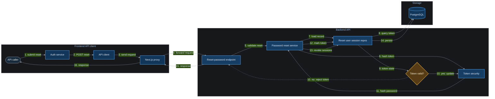

```mermaid
%%{init: {'theme':'base','themeVariables':{'background':'#111214','primaryColor':'#102b4a','primaryTextColor':'#e6f0ff','primaryBorderColor':'#3d6f9f','lineColor':'#9aa4b2','clusterBkg':'#16181c','clusterBorder':'#2a2e35','fontSize':'15px'}}}%%
flowchart LR
  subgraph USER[User and browser]
    User([User])
  end
  subgraph FE[Frontend]
    Forms[Register and login]
    AuthClient[Auth service]
    ApiClient[API client]
    Proxy[Next.js proxy]
  end
  subgraph API[Backend API]
    AuthAPI[Auth endpoints]
    Service[Auth service]
    Security[Token security]
    Repos[User and session repos]
  end
  subgraph DB[Storage]
    Postgres[(PostgreSQL)]
  end

  User -->|1. submit| Forms
  Forms -->|2. register or login| AuthClient
  AuthClient -->|3. POST auth| ApiClient
  ApiClient -->|4. credentials included| Proxy
  Proxy -->|5. forward request| AuthAPI
  AuthAPI -->|6. authenticate account| Service
  Service -->|7. hash/verify| Security
  Service -->|8. save user/session| Repos
  Repos -->|9. SQL records| Postgres
  AuthAPI -->|10. cookie response| Proxy
  Proxy -->|11. forward headers| ApiClient
  ApiClient -->|12. result| Forms

  classDef user fill:#172b3c,stroke:#7b8794,color:#f1f5f9;
  classDef frontend fill:#12365a,stroke:#4b91d1,color:#e6f0ff,stroke-width:2px;
  classDef backend fill:#163d63,stroke:#4b91d1,color:#e6f0ff,stroke-width:2px;
  classDef storage fill:#12365a,stroke:#4b91d1,color:#e6f0ff,stroke-width:2px;
  class User user;
  class Forms,AuthClient,ApiClient,Proxy frontend;
  class AuthAPI,Service,Security,Repos backend;
  class Postgres storage;
  %% Legend: solid = normal calls; dashed = conditional; blue = application/storage; gray = user; amber = decision.
```

Caption: Registration creates a user; login verifies the password, creates a session, then returns token data and HttpOnly cookies.
- Notice: Passwords are Argon2id-hashed; refresh tokens are stored as hashes.
- Notice: The browser API client includes credentials; the Next.js proxy forwards backend response headers.

```mermaid
%%{init: {'theme':'base','themeVariables':{'background':'#111214','primaryColor':'#102b4a','primaryTextColor':'#e6f0ff','primaryBorderColor':'#3d6f9f','lineColor':'#9aa4b2','clusterBkg':'#16181c','clusterBorder':'#2a2e35','fontSize':'15px'}}}%%
flowchart LR
  subgraph FE[Frontend]
    Browser([Browser])
    AuthClient[Auth service]
    ApiClient[API client]
    Proxy[Next.js proxy]
  end
  subgraph API[Backend API]
    AuthAPI[Auth endpoints]
    Service[Auth service]
    Security[Token security]
    Replay{Token reused?}
    Sessions[Session repository]
  end
  subgraph DB[Storage]
    Postgres[(PostgreSQL)]
  end

  Browser -->|1. session action| AuthClient
  AuthClient -->|2. POST auth| ApiClient
  ApiClient -->|3. send cookies| Proxy
  Proxy -->|4. forward request| AuthAPI
  AuthAPI -->|5. handle session| Service
  Service -->|6. hash token| Security
  Security -->|7. token hash| Service
  Service -->|8. lookup token| Sessions
  Sessions -->|9. query session| Postgres
  Postgres -->|10. session row| Sessions
  Sessions -->|11. return record| Service
  Service -->|12. check reuse| Replay
  Replay -->|13. replay revoke| Sessions
  Replay -->|14. valid continue| Service
  Service -->|15. issue tokens| Security
  Security -->|16. token pair| Service
  Service -->|17. save or revoke| Sessions
  Sessions -->|18. persist session| Postgres
  Service -->|19. token result| AuthAPI
  AuthAPI -->|20. cookie update| Proxy
  Proxy -->|21. response| Browser

  classDef user fill:#172b3c,stroke:#7b8794,color:#f1f5f9;
  classDef frontend fill:#12365a,stroke:#4b91d1,color:#e6f0ff,stroke-width:2px;
  classDef backend fill:#163d63,stroke:#4b91d1,color:#e6f0ff,stroke-width:2px;
  classDef decision fill:#563c14,stroke:#d9a441,color:#fff7df,stroke-width:2px;
  classDef storage fill:#12365a,stroke:#4b91d1,color:#e6f0ff,stroke-width:2px;
  class Browser user;
  class AuthClient,ApiClient,Proxy frontend;
  class AuthAPI,Service,Security,Sessions backend;
  class Replay decision;
  class Postgres storage;
  %% Legend: solid = normal calls; dashed = conditional; blue = application/storage; gray = user; amber = decision.
```

Caption: Refresh rotates a session token; reuse of a revoked token revokes its token family. Logout revokes the presented session.
- Notice: Refresh and access tokens travel in HttpOnly cookies; the refresh cookie is path-scoped.
- Notice: A reused token triggers family revocation; an expired token is revoked and rejected.

```mermaid
%%{init: {'theme':'base','themeVariables':{'background':'#111214','primaryColor':'#102b4a','primaryTextColor':'#e6f0ff','primaryBorderColor':'#3d6f9f','lineColor':'#9aa4b2','clusterBkg':'#16181c','clusterBorder':'#2a2e35','fontSize':'15px'}}}%%
flowchart LR
  subgraph FE[Frontend]
    Browser([Browser])
    Provider[Auth state provider]
    AuthClient[Auth service]
    ApiClient[API client]
    Proxy[Next.js proxy]
  end
  subgraph API[Backend API]
    Me[Current-user endpoint]
    Dependency[Auth dependency]
    Security[Token security]
    Users[User repository]
  end
  subgraph DB[Storage]
    Postgres[(PostgreSQL)]
  end

  Browser -->|1. load application| Provider
  Provider -->|2. request current user| AuthClient
  AuthClient -->|3. GET me| ApiClient
  ApiClient -->|4. include cookies| Proxy
  Proxy -->|5. forward request| Me
  Me -->|6. require identity| Dependency
  Dependency -->|7. decode access token| Security
  Dependency -->|8. load active user| Users
  Users -->|9. query by id| Postgres
  Users -->|10. return identity| Dependency
  Dependency -->|11. authenticated user| Me
  Me -->|12. response| Proxy
  Proxy -->|13. forward response| Provider

  classDef user fill:#172b3c,stroke:#7b8794,color:#f1f5f9;
  classDef frontend fill:#12365a,stroke:#4b91d1,color:#e6f0ff,stroke-width:2px;
  classDef backend fill:#163d63,stroke:#4b91d1,color:#e6f0ff,stroke-width:2px;
  classDef storage fill:#12365a,stroke:#4b91d1,color:#e6f0ff,stroke-width:2px;
  class Browser user;
  class Provider,AuthClient,ApiClient,Proxy frontend;
  class Me,Dependency,Security,Users backend;
  class Postgres storage;
  %% Legend: solid = normal calls; dashed = conditional; blue = application/storage; gray = user; amber = decision.
```

Caption: On application load, the auth provider calls `/auth/me`; the backend validates the access token and loads the active user.
- Notice: Missing, invalid, expired, or inactive-user credentials are rejected by the auth dependency.
- Notice: The provider clears its local user state if the current-user request fails.

```mermaid
%%{init: {'theme':'base','themeVariables':{'background':'#111214','primaryColor':'#102b4a','primaryTextColor':'#e6f0ff','primaryBorderColor':'#3d6f9f','lineColor':'#9aa4b2','clusterBkg':'#16181c','clusterBorder':'#2a2e35','fontSize':'15px'}}}%%
flowchart LR
  subgraph FE[Frontend API client]
    Caller([API caller])
    AuthClient[Auth service]
    ApiClient[API client]
    Proxy[Next.js proxy]
  end
  subgraph API[Backend API]
    Endpoint[Forgot-password endpoint]
    Reset[Password reset service]
    Known{Active user?}
    Security[Token security]
    Repos[Reset repository]
  end
  subgraph DB[Storage]
    Postgres[(PostgreSQL)]
  end

  Caller -->|1. reset request| AuthClient
  AuthClient -->|2. POST reset| ApiClient
  ApiClient -->|3. send request| Proxy
  Proxy -->|4. forward request| Endpoint
  Endpoint -->|5. create token| Reset
  Reset -->|6. check user| Known
  Known -->|7. yes: generate| Security
  Security -->|8. hash token| Repos
  Repos -->|9. store token| Postgres
  Known -.->|7. no: skip| Endpoint
  Reset -.->|10. optional token| Endpoint
  Endpoint -->|11. generic response| Proxy
  Proxy -->|12. response| Caller

  classDef user fill:#172b3c,stroke:#7b8794,color:#f1f5f9;
  classDef frontend fill:#12365a,stroke:#4b91d1,color:#e6f0ff,stroke-width:2px;
  classDef backend fill:#163d63,stroke:#4b91d1,color:#e6f0ff,stroke-width:2px;
  classDef decision fill:#563c14,stroke:#d9a441,color:#fff7df,stroke-width:2px;
  classDef storage fill:#12365a,stroke:#4b91d1,color:#e6f0ff,stroke-width:2px;
  class Caller user;
  class AuthClient,ApiClient,Proxy frontend;
  class Endpoint,Reset,Security,Repos backend;
  class Known decision;
  class Postgres storage;
  %% Legend: solid = normal calls; dashed = conditional; blue = application/storage; gray = user; amber = decision.
```

Caption: Forgot-password requests always return a generic confirmation; active users get a hashed, expiring token stored in PostgreSQL.
- Notice: The endpoint discards the raw token; no email or delivery service is wired here.
- Notice: No forgot-password screen was found under `frontend/src/app`; only API helper methods exist.

Caption: The reset endpoint validates a single-use, unexpired token, changes the password, and revokes the user’s existing sessions.
- Notice: Invalid, expired, or already-used tokens are rejected.
- Notice: Password reset revokes every active session for that user.

Evidence
- `frontend/src/features/auth/login.tsx:13-37`
- `frontend/src/features/auth/register.tsx:12-34`
- `frontend/src/features/auth/provider.tsx:17-47`
- `frontend/src/features/auth/service.ts:10-45`
- `frontend/src/lib/apiClient.ts:1-42`
- `frontend/src/app/api/[...path]/route.ts:1-58`
- `backend/app/api/v1/router.py:1-15`
- `backend/app/main.py:106-107`
- `backend/app/api/v1/endpoints/auth.py:22-197`
- `backend/app/services/auth_service.py:24-135`
- `backend/app/core/security.py:13-72`
- `backend/app/dependencies/auth.py:14-61`
- `backend/app/repositories/user_repository.py:9-54`
- `backend/app/repositories/session_repository.py:10-66`
- `backend/app/services/password_reset_service.py:17-77`
- `backend/app/repositories/password_reset_repository.py:10-53`
- `frontend/src/app/login/page.tsx:1-5`
- `frontend/src/app/register/page.tsx:1-5`
- `backend/app/models/user.py:11-67`
- `backend/app/models/user_session.py:11-54`
- `UNVERIFIED: frontend forgot/reset page; no such page appeared in the inspected frontend/src/app file list.`
